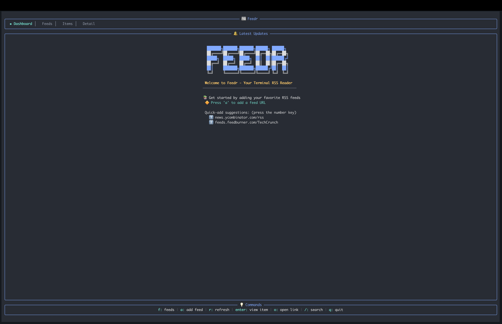

# Feedr - Terminal RSS Feed Reader 📰

Feedr is a feature-rich terminal-based RSS feed reader written in Rust. It provides a clean, intuitive TUI interface for managing and reading RSS feeds with elegant visuals and smooth keyboard navigation.



## Demo


## Features

- **Dashboard View**: See the latest articles across all your feeds, sorted chronologically
- **Feed Management**: Subscribe to and organize multiple RSS/Atom feeds
- **Feed Auto-Discovery**: Paste any webpage URL and Feedr will detect and offer to subscribe to its RSS/Atom feeds
- **Starred Articles**: Save articles for later with a dedicated starred view
- **Categories**: Organize feeds into custom categories with create, rename, and delete support
- **Tree View**: Browse feeds in a hierarchical tree grouped by category
- **Advanced Filtering**: Filter articles by category, age, author, read status, starred status, and content length
- **Dual Themes**: Switch between a dark cyberpunk theme and a light zen theme with `t`
- **Live Search**: Instantly search across all feed titles and article content
- **Summary View**: "What's New" screen shows articles added since your last session with per-feed stats
- **Read/Unread Tracking**: Persistent read state tracking across sessions
- **Mark All Read**: Quickly mark all visible items as read with `m`
- **Article Preview**: Toggle an inline preview pane in the dashboard view, or have it open at launch with `show_preview = true`
- **Link Extraction**: Extract and browse all links from an article with `l`
- **Full-Text Extraction**: Strip away summaries and read the actual article content inline via Mozilla Readability — manual on `Shift+F`, or auto-extract on refresh per feed with `fulltext = true`
- **Inline Images**: When an article has a `<media:thumbnail>` (e.g. YouTube channel feeds, web-comic RSS), Feedr renders it inline in the detail view via the Kitty graphics protocol. Auto-detected on Ghostty, Kitty, and WezTerm; silently no-ops elsewhere. Images are fetched in the background — read or open in browser without waiting.
- **Help Overlay**: Press `?` for a scrollable keybinding reference overlay
- **OPML Import**: Bulk import feeds from OPML files via `feedr --import <file.opml>`
- **Browser Integration**: Open articles in your default browser
- **Mouse Support**: Click to select items and scroll with the mouse wheel
- **Background Refresh**: Automatic feed updates with configurable intervals and smart rate limiting
- **Rate Limiting**: Per-domain request throttling prevents "too many requests" errors (ideal for Reddit feeds)
- **Vim-Style Navigation**: Use `j`/`k` alongside arrow keys for navigation
- **Rich Content Display**: HTML-to-text conversion with clean article formatting
- **Authenticated Feeds**: Support for custom HTTP headers per feed (e.g., `Authorization: Bearer ...`) for private/authenticated RSS feeds
- **Compact Mode**: Automatic compact layout for small terminals (≤30 rows), with manual `always`/`never` override in config
- **CLI Config Management**: Get, set, and list configuration from the command line (`feedr config`), or use the interactive TUI config editor (`feedr config --tui`)
- **Configurable Keybindings**: Remap any key action via the `[keybindings]` section in `config.toml`
- **External-Command Hooks**: Newsboat-style macros (`pipe-to`, `exec`) bound to keys, plus `exec_on_new` notifications fired per new item — all with shell-free argument templating
- **Configurable**: Customize timeouts, themes, UI behavior, and default feeds via TOML config
- **XDG Compliant**: Follows standard directory specifications for configuration and data storage

## Installation

### Prerequisites

- Rust and Cargo (install from [https://rustup.rs/](https://rustup.rs/))

### Using Cargo Install (Recommended)
```bash
cargo install feedr
```

### Arch Linux (AUR)
Feedr is available on the [AUR](https://aur.archlinux.org/packages/feedr). Install it using your preferred AUR helper:
```bash
paru -S feedr
# or
yay -S feedr
```

### Build from Source
```bash
git clone https://github.com/bahdotsh/feedr.git
cd feedr
cargo build --release
```

The binary will be available at `target/release/feedr`.

## Usage

Run the application:

```bash
feedr
```

### OPML Import

Import feeds from an OPML file:
```bash
feedr --import feeds.opml
```

### Configuration Management

View and modify settings from the command line:
```bash
feedr config list                      # List all settings with current values
feedr config get ui.theme              # Get a single value
feedr config set ui.theme light        # Set a value (with validation)
feedr config --tui                     # Open interactive TUI config editor
```

Available config keys use dot-notation (e.g. `general.max_dashboard_items`, `network.http_timeout`, `ui.theme`, `ui.compact_mode`). Run `feedr config list` to see all keys. Feed management (`default_feeds`) is only available through the TUI editor.

### Quick Start
1. When you open Feedr for the first time, press `a` to add a feed
2. Enter a valid RSS feed URL (e.g., `https://news.ycombinator.com/rss`)
3. You can also press `1`, `2`, or `3` to quickly add Hacker News, TechCrunch, or BBC News
4. Use arrow keys (or `j`/`k`) to navigate and `Enter` to view items
5. Press `o` to open the current article in your browser
6. Press `t` to toggle between dark and light themes

### Keyboard Controls

All keybindings below show their defaults. You can remap any action via the `[keybindings]` section in your config file — see [Configurable Keybindings](#configurable-keybindings).

#### General Navigation
| Key | Action |
|-----|--------|
| `Tab` | Cycle forward through views |
| `Shift+Tab` | Cycle backward through views |
| `q` | Go back (quit from Dashboard) |
| `h` / `Esc` / `Backspace` | Go back one view |
| `Home` | Return to Dashboard |
| `Ctrl+Q` | Quit from any view |
| `r` | Refresh all feeds |
| `t` | Toggle dark/light theme |
| `/` | Search mode |
| `?` | Help overlay (scrollable keybinding reference) |

#### Dashboard View
| Key | Action |
|-----|--------|
| `↑/↓` or `k/j` | Navigate items |
| `g` / `G` or `End` | Jump to top / bottom |
| `Enter` | View selected item |
| `f` | Filter articles |
| `c` | Cycle category filter |
| `Ctrl+C` | Open category management |
| `a` | Add a new feed |
| `s` | Toggle starred |
| `Space` | Toggle read/unread |
| `m` | Mark all items as read |
| `p` | Toggle preview pane |
| `Shift+J` / `Shift+K` | Scroll preview down / up |
| `o` | Open link in browser |
| `1/2/3` | Quick-add demo feeds (HN, TechCrunch, BBC) |

#### Feed List View
| Key | Action |
|-----|--------|
| `q` / `h` / `Esc` | Go to dashboard |
| `↑/↓` or `k/j` | Navigate feeds |
| `Enter` | View feed items |
| `Space` | Expand/collapse category (tree view) |
| `a` | Add a new feed |
| `d` | Delete selected feed |
| `c` | Assign category to feed |

#### Feed Items View
| Key | Action |
|-----|--------|
| `q` / `h` / `Esc` / `Backspace` | Back to feeds list |
| `Home` | Go to dashboard |
| `↑/↓` or `k/j` | Navigate items |
| `g` / `G` or `End` | Jump to top / bottom |
| `Enter` | View item details |
| `s` | Toggle starred |
| `Space` | Toggle read/unread |
| `m` | Mark all items as read |
| `o` | Open item in browser |

#### Item Detail View
| Key | Action |
|-----|--------|
| `q` / `h` / `Esc` / `Backspace` | Back to feed items |
| `↑/↓` or `k/j` | Scroll content |
| `Ctrl+U` / `Ctrl+D` | Scroll content (page) |
| `Page Up` / `Page Down` | Scroll content (page) |
| `g` | Jump to top |
| `G` / `End` | Jump to bottom |
| `s` | Toggle starred |
| `o` | Open item in browser |
| `l` | Extract and show all links |
| `Shift+F` | Toggle/fetch full-text (Readability) |
| `f` | Toggle read mode (fullscreen) |

#### Starred View
| Key | Action |
|-----|--------|
| `↑/↓` or `k/j` | Navigate items |
| `Enter` | View item details |
| `s` | Remove from starred |
| `o` | Open item in browser |

#### Categories View
| Key | Action |
|-----|--------|
| `n` | Create new category |
| `e` | Rename category |
| `d` | Delete category |
| `Space` | Expand/collapse category |
| `Enter` | Select category |
| `r` | Refresh |
| `?` | Help |
| `h` / `Esc` / `q` | Back |

#### Filter Mode (press `f` on Dashboard)
| Key | Action |
|-----|--------|
| `c` | Filter by category |
| `t` | Filter by time/age |
| `a` | Filter by author |
| `r` | Filter by read status |
| `s` | Filter by starred status |
| `l` | Filter by content length |
| `x` | Clear all filters |

#### Mouse Support
| Action | Effect |
|--------|--------|
| Left click | Select item |
| Scroll up/down | Navigate items |

## Configuration

Feedr supports customization through a TOML configuration file that follows XDG Base Directory specifications. You can edit the file directly, use `feedr config get/set` from the command line, or use `feedr config --tui` for an interactive editor.

### Configuration File Location

- **Linux/macOS**: `~/.config/feedr/config.toml`
- **Windows**: `%APPDATA%\feedr\config.toml`

The configuration file is automatically generated with default values on first run if it doesn't exist.

### Available Settings

```toml
# Feedr Configuration File

[general]
max_dashboard_items = 100           # Maximum number of items shown on dashboard
auto_refresh_interval = 0           # Auto-refresh interval in seconds (0 = disabled)
refresh_enabled = false             # Enable automatic background refresh
refresh_rate_limit_delay = 2000     # Delay in milliseconds between requests to same domain

[network]
http_timeout = 15              # HTTP request timeout in seconds
user_agent = "Mozilla/5.0 (compatible; Feedr/1.0; +https://github.com/bahdotsh/feedr)"

[ui]
tick_rate = 100                # UI update rate in milliseconds
error_display_timeout = 3000   # Error message duration in milliseconds
theme = "dark"                 # Theme: "dark" (cyberpunk) or "light" (zen)
compact_mode = "auto"          # Compact layout: "auto", "always", or "never"
show_preview = false           # Start with the dashboard preview pane open

# Optional: Define default feeds to load on first run
[[default_feeds]]
url = "https://example.com/feed.xml"
category = "News"

# Authenticated feed with custom HTTP headers
[[default_feeds]]
url = "https://private.example.com/feed.xml"
[default_feeds.headers]
Authorization = "Bearer your_token_here"
```

### Configuration Options Explained

#### General Settings
- **max_dashboard_items**: Controls how many items are displayed on the dashboard (default: 100)
- **auto_refresh_interval**: Automatically refresh feeds at specified interval in seconds (0 disables auto-refresh)
- **refresh_enabled**: Master switch to enable/disable automatic background refresh (default: false)
- **refresh_rate_limit_delay**: Delay in milliseconds between requests to the same domain to prevent "too many requests" errors (default: 2000ms). This is especially useful for Reddit feeds and other rate-limited services.

#### Network Settings
- **http_timeout**: Timeout for HTTP requests when fetching feeds (useful for slow connections)
- **user_agent**: Custom User-Agent string for HTTP requests

#### UI Settings
- **tick_rate**: How frequently the UI updates in milliseconds (lower = more responsive, higher = less CPU usage)
- **error_display_timeout**: How long error messages are displayed in milliseconds
- **theme**: Choose between `"dark"` (cyberpunk aesthetic with neon colors) or `"light"` (zen minimalist with organic colors). Can also be toggled at runtime with `t`.
- **compact_mode**: Controls the compact layout for small terminals. `"auto"` (default) enables compact mode when terminal height is ≤30 rows, `"always"` forces compact mode, and `"never"` disables it. Compact mode uses single-line items, a minimal title bar, and an abbreviated help bar to maximize screen real estate.
- **show_preview**: When `true`, the dashboard preview pane is open at launch (default: `false`). The `p` key still toggles it at runtime. Note that the preview pane is always hidden while compact mode is active.

#### Background Refresh Example
To enable automatic refresh every 5 minutes with rate limiting:
```toml
[general]
refresh_enabled = true
auto_refresh_interval = 300  # 5 minutes
refresh_rate_limit_delay = 2000  # 2 seconds between requests to same domain
```

**Note**: Rate limiting groups feeds by domain and staggers requests to prevent hitting API limits. For example, if you have multiple Reddit feeds, they will be fetched with a 2-second delay between each request to avoid getting blocked.

#### Default Feeds
You can define feeds to be automatically loaded on first run:
```toml
[[default_feeds]]
url = "https://news.ycombinator.com/rss"
category = "Tech"

[[default_feeds]]
url = "https://example.com/feed.xml"
category = "News"

# Optional per-feed refresh threshold (seconds). When this elapses since
# the last refresh, the next auto-refresh tick is triggered — currently
# all feeds are refreshed together (no true selective per-feed refresh).
# Requires `general.refresh_enabled = true`.
[[default_feeds]]
url = "https://example.com/fast-feed.xml"
refresh_interval = 60
```

#### Authenticated Feeds
Some RSS feeds require authentication or custom HTTP headers. You can configure per-feed headers:
```toml
[[default_feeds]]
url = "https://private.example.com/feed.xml"
[default_feeds.headers]
Authorization = "Bearer your_api_token"

[[default_feeds]]
url = "https://another-api.example.com/rss"
[default_feeds.headers]
X-API-Key = "your_api_key"
Cookie = "session=abc123"
```
Headers are sent with every request for that feed, including refreshes.

#### Full-Text Extraction
Most RSS feeds ship only short summaries. Feedr can fetch the linked article URL and run [Mozilla Readability](https://github.com/mozilla/readability) (via the `dom_smoothie` crate) to extract the actual article body and render it inline.

- **Manual**: in the article detail view, press `Shift+F` to extract the focused article. Press `Shift+F` again to toggle back to the original summary, or after a failure to retry.
- **Auto on refresh**: set `fulltext = true` on a feed and Feedr will auto-extract newly-seen items on each refresh (same "no firehose" rule as `exec_on_new` — the first observation of a feed seeds silently).

```toml
[[default_feeds]]
url = "https://example.com/summary-only-feed.xml"
fulltext = true
```

Notes:
- Extracted content is **in-memory only** — it is not persisted to disk. A restart re-extracts on demand.
- Per-feed auth headers are **not** sent to the article URL (article URLs are typically third-party hosts; forwarding `Authorization` would leak credentials).
- Pages with very short extracted bodies (likely JS-rendered or behind a wall) fail gracefully and fall back to showing the original summary.

### External-Command Hooks

Feedr supports newsboat-style external commands for two workflows: **macros** (key-triggered chains that act on the focused article) and **`exec_on_new`** (a notification hook fired per newly-seen item after each refresh).

**Commands are not run through a shell.** Templates are tokenized once at config load, and `%X` placeholders are substituted into individual `argv` tokens — feed content can never break out of an argument. For pipes, redirection, or globbing, write a small shell script and invoke that.

#### Template Variables

Expanded in every `argv` token of macro and hook commands:

| Variable | Expands to |
|----------|------------|
| `%t` | Article title |
| `%u` | Article URL |
| `%a` | Author |
| `%d` | Formatted publish date |
| `%f` | Feed title |
| `%F` | Feed URL |
| `%m` | Primary media URL (`<media:content>`, `<enclosure>`, or Atom `<content src>`) |
| `%M` | MIME type of the primary media |
| `%i` | First `<media:thumbnail>` URL on the item |
| `%%` | Literal `%` |

`%m`/`%M`/`%i` expand to the empty string when an item has no media — they're **orthogonal** to `%u` (no fallback). For YouTube channel feeds the watch-page URL is `%u`; the in-feed video URL is `%m`. For RSS podcasts the episode page is `%u`; the audio file is `%m`.

#### Macros

A macro binds a key to an ordered chain of steps. Trigger with `<prefix><key>` (default prefix is `,`). Steps are separated by `;`. An optional trailing ` -- "description"` overrides the help-overlay label.

```toml
[macros]
y = 'open-in-browser ; pipe-to "yt-dlp %u"'
w = 'pipe-to "wallabag-cli add %u" -- "Save to Wallabag"'
n = 'pipe-to "tee /tmp/out.txt" stdin=metadata'

# Media-rich feeds (YouTube channels, web comics, podcasts):
v = 'exec "mpv %u" -- "Play in mpv"'         # YouTube: mpv resolves the watch URL via yt-dlp
d = 'exec "yt-dlp -o ~/Videos/%(title)s.%(ext)s %u" -- "Download with yt-dlp"'
p = 'exec "mpv %m" -- "Play media file"'     # Podcasts: direct .mp3 URL is %m
i = 'exec "feh %i" -- "View thumbnail"'      # Web comics / YT thumbnails

[macro_options]
prefix = ","                  # the macro-prefix key
pipe_default_stdin = "body"   # body | title | url | metadata | none
```

**Step kinds:**
- `<action>` — invoke a built-in action. Supported in macros: `open-in-browser`, `toggle-star`, `toggle-read`, `mark-all-read`, `refresh`, `toggle-theme`, `extract-links`, `fetch-full-text`, `help`.
- `pipe-to "cmd %u" [stdin=…]` — suspend the TUI, run the command, and pipe article content to its stdin. `stdin` is one of `body` (default), `title`, `url`, `metadata`, or `none`.
- `exec "cmd %u"` — spawn the command detached (no stdin, no terminal takeover).

Chains halt on the first step error. Press `Esc` after the prefix to cancel; an unbound follow-up surfaces a "No macro bound" error. Macros are also rendered in the help overlay (`?`).

#### `exec_on_new` Notifications

Fire a command once per newly-seen item after each refresh. The first successful fetch of each feed seeds the seen-set silently — you do **not** get a firehose on initial load or first run.

```toml
[hooks]
exec_on_new = 'notify-send "New: %t" "%f"'
```

Children are spawned **detached** so the TUI never blocks on them. Crash semantics are **at-most-once**: feedr persists the seen-set before spawning, so a kill mid-fire loses a notification rather than re-firing on the next launch. Prefer idempotent commands (e.g. `wallabag-cli add` is safe; `mail-me` is not).

#### Security Notes

- The shell is never invoked, so feed content in `%t` / `%a` / etc. cannot escape an argument.
- **Do not wrap your command in `sh -c "... %t ..."`** — that reintroduces shell injection through item titles. Write a script file and invoke it instead.
- `~` / `$HOME` / `$VAR` are **not** expanded — use absolute paths.
- If a macro's command template has unbalanced quotes or names an unknown action, feedr surfaces a startup warning rather than failing silently at trigger time.

### Configurable Keybindings

Remap any action by adding a `[keybindings]` section to your config file. Each action can be bound to a single key string or an array of keys:

```toml
[keybindings]
quit = "x"                          # Single key
move_up = ["Up", "k", "w"]         # Multiple keys
force_quit = "Ctrl+x"              # Modifier keys
toggle_theme = "F5"                # Function keys
```

**Available actions:**

| Action | Default | Description |
|--------|---------|-------------|
| `quit` | `q` | Go back / quit from Dashboard |
| `force_quit` | `Ctrl+q` | Quit from any view |
| `back` | `h`, `Esc`, `Backspace` | Go back one view |
| `home` | `Home` | Return to Dashboard |
| `toggle_theme` | `t` | Switch dark/light theme |
| `refresh` | `r` | Refresh all feeds |
| `help` | `?` | Show help overlay |
| `open_search` | `/` | Enter search mode |
| `move_up` | `Up`, `k` | Navigate up |
| `move_down` | `Down`, `j` | Navigate down |
| `page_up` | `PageUp`, `Ctrl+u` | Page up |
| `page_down` | `PageDown`, `Ctrl+d` | Page down |
| `jump_top` | `g` | Jump to top |
| `jump_bottom` | `G`, `End` | Jump to bottom |
| `select` | `Enter` | Select / open |
| `add_feed` | `a` | Add new feed |
| `delete_feed` | `d` | Delete selected feed |
| `toggle_read` | `Space` | Toggle read/unread |
| `toggle_star` | `s` | Toggle starred |
| `mark_all_read` | `m` | Mark all items as read |
| `open_in_browser` | `o` | Open in browser |
| `toggle_preview` | `p` | Toggle preview pane |
| `open_filter` | `f` | Open filter mode |
| `cycle_category` | `c` | Cycle category filter |
| `open_category_management` | `Ctrl+c` | Category management |
| `assign_category` | `c` | Assign category to feed |
| `extract_links` | `l` | Extract links from article |
| `fetch_full_text` | `Shift+F` | Toggle/fetch full-text (Readability) |
| `toggle_read_mode` | `f` | Toggle read mode (fullscreen) |
| `scroll_preview_up` | `Shift+K`, `Shift+Up` | Scroll preview up |
| `scroll_preview_down` | `Shift+J`, `Shift+Down` | Scroll preview down |
| `toggle_expand` | `Space` | Expand/collapse in tree view |
| `next_tab` | `Tab` | Next view |
| `prev_tab` | `Shift+Tab` | Previous view |

**Supported key formats:** Single characters (`q`, `?`, `/`), special keys (`Enter`, `Space`, `Tab`, `Esc`, `Backspace`, `Up`, `Down`, `Left`, `Right`, `Home`, `End`, `PageUp`, `PageDown`, `Delete`, `F1`–`F5`), and modifier combos (`Ctrl+q`, `Shift+Tab`, `Alt+x`).

### Data Storage

Feedr stores your bookmarks, categories, read/unread state, and starred articles in:
- **Linux/macOS**: `~/.local/share/feedr/feedr_data.json`
- **Windows**: `%LOCALAPPDATA%\feedr\feedr_data.json`

### Backwards Compatibility

Feedr automatically migrates data from older versions to the new XDG-compliant locations. Your existing data will be preserved and automatically moved to the correct location on first run.

## Dependencies

- **[ratatui](https://github.com/ratatui-org/ratatui)**: Terminal UI framework
- **[crossterm](https://github.com/crossterm-rs/crossterm)**: Terminal manipulation
- **[reqwest](https://github.com/seanmonstar/reqwest)**: HTTP client (with gzip/deflate/brotli support)
- **[feed-rs](https://github.com/feed-rs/feed-rs)**: RSS and Atom feed parsing
- **[html2text](https://github.com/servo/html5ever)**: HTML to text conversion
- **[chrono](https://github.com/chronotope/chrono)**: Date and time handling
- **[serde](https://github.com/serde-rs/serde)**: Serialization/deserialization
- **[clap](https://github.com/clap-rs/clap)**: Command-line argument parsing
- **[opml](https://github.com/Holllo/opml)**: OPML import support
- **[toml](https://github.com/toml-rs/toml)**: Configuration file parsing
- **[scraper](https://github.com/causal-agent/scraper)**: HTML parsing for feed auto-discovery
- **[url](https://github.com/servo/rust-url)**: URL parsing and manipulation
- **[dom_smoothie](https://github.com/niklak/dom_smoothie)**: Mozilla Readability port for full-text extraction
- **[encoding_rs](https://github.com/hsivonen/encoding_rs)**: Charset detection for non-UTF-8 article pages
- **[shlex](https://github.com/comex/rust-shlex)**: Shell-style tokenization for macro/hook command templates

## License

MIT

## Contributing

Contributions are welcome! Please feel free to submit a Pull Request.

1. Fork the repository
2. Create your feature branch (`git checkout -b feature/amazing-feature`)
3. Commit your changes (`git commit -m 'Add some amazing feature'`)
4. Push to the branch (`git push origin feature/amazing-feature`)
5. Open a Pull Request
